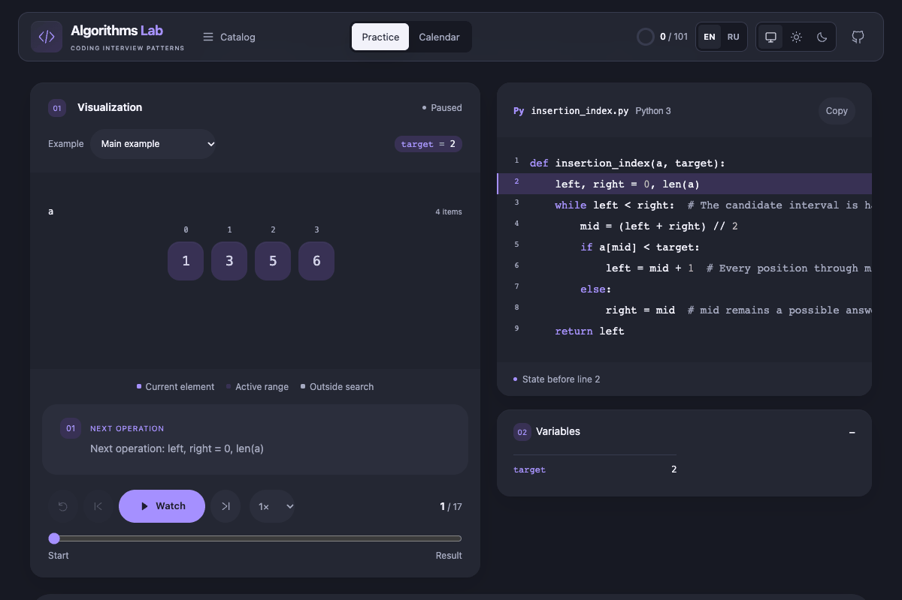

# Algorithms Lab

**Step through coding interview patterns in Python.**

Explore **101 Python interview problems** through step-by-step execution visualizations, **19 pattern guides** and **404 verified examples**. English by default, with a complete Russian option.

**[Try the live demo →](https://glec1er.github.io/algorithms/)** · [Start with binary search](https://glec1er.github.io/algorithms/?lang=en#/problem/insertion_index) · [Русский README](README.ru.md)



- **See what every line changes.** Arrays, pointers, linked nodes, trees, graphs, heaps, DP tables, a call stack and local variables stay connected to the displayed Python.
- **Learn the reasoning.** Each pattern includes recognition signals, an invariant, a worked example, comparisons and common mistakes.
- **Build a practice habit.** Track understood problems, weekday goals, XP and streaks locally. Export a JSON backup to keep or transfer your history.
- **Make the workspace yours.** Choose light, dark or system appearance. Py, an optional robot-python companion, reacts to the trace; pause its motion or hide it from Appearance. Reduced motion is respected. [How Py works](docs/mascot.md).

No account or server required. No analytics. MIT licensed.

## Explore

| Pattern | Example |
| --- | --- |
| Binary search | [Find the insertion index](https://glec1er.github.io/algorithms/?lang=en#/problem/insertion_index) |
| Two pointers | [Pair sum in a sorted array](https://glec1er.github.io/algorithms/?lang=en#/problem/pair_sum_sorted) |
| Linked lists | [Reverse a list](https://glec1er.github.io/algorithms/?lang=en#/problem/linked_reversal) |
| Graphs | [Shortest weighted paths](https://glec1er.github.io/algorithms/?lang=en#/problem/shortest_path) |
| Dynamic programming | [Longest common subsequence](https://glec1er.github.io/algorithms/?lang=en#/problem/lcs) |

The full catalog also covers hash maps and sets, fast/slow pointers, sliding windows, stacks, heaps, intervals, prefix sums, trees, tries, backtracking, greedy algorithms, sorting/selection, bit manipulation, math and geometry.

## How it works

Python runs **at build time**. The compiler records actual line events and checks each example against its independently specified expected answer. The static website replays these prepared traces; it does **not** execute arbitrary Python or accept custom inputs.

A highlighted line shows the state **before** that line runs. The final frame contains the returned result. Node IDs preserve reference identity, and array identities make rearrangements easier to follow. Example preparation and rendering are separate from the displayed algorithm complexity.

Use the English/Russian selector at any time; it preserves your current example, frame and progress. Shared links can specify `?lang=en` or `?lang=ru` before the hash route. A fresh visit defaults to English regardless of browser language.

## Run locally

Requires **Node.js 24+**, npm and **Python 3.10+**. Python uses only the standard library.

```sh
npm ci
npm run dev
```

Open the Vite address with the `/algorithms/` path.

```sh
npm test              # Python algorithms/traces/translations; Node progress/locale/backup tests
npm run check         # Generate lessons, run unit checks and check TypeScript
npm run build         # Verify examples, check types and build dist/
npm run preview       # Serve the production build on port 4173
npm run test:browser  # Run with the preview server running
```

Local browser tests use installed Google Chrome. CI uses Playwright Chromium: install it with `npx playwright install --with-deps chromium`, then run tests with `CI=true`. Set `LAB_URL` to test a different preview URL.

## Controls and progress

- **← / →**: previous/next execution frame. **Space**: play/pause outside inputs, links and focused buttons.
- Use the example selector, timeline and playback speed to explore different prepared cases.
- **Mark as understood** saves a completion. The first completion of a problem earns 100 XP; reviewing or toggling it again does not award extra XP. Each 500 XP advances a level.
- A weekday goal is one new problem from Monday through Friday. Weekends are optional and do not break streaks. Required goals end when the curriculum is completed.
- History is stored only in this browser and origin. Clearing browser data removes it. Use **Calendar → Export progress** for backups. Imports show a validation preview, ask before replacing history and download the previous state first.
- Earlier undated completions keep their XP without inventing historical dates. If storage is unavailable, the current tab remains usable with a warning.

## Project structure

| Path | Responsibility |
| --- | --- |
| `curriculum/catalog.py`, `patterns.py`, `english.py` | Original lesson content, worked examples and validated bilingual material |
| `curriculum/ch01.py` … `ch19.py` | Executable Python solutions |
| `curriculum/structures.py`, `runtime.py` | Example adapters and bounded state recording |
| `scripts/build_lessons.py` | Verify 404 examples and generate the catalog and lesson payloads |
| `src/components/`, `src/Home.tsx`, `src/App.tsx` | Visual scenes, discovery, player and practice screens |
| `src/locale.ts`, `i18n.tsx`, `messages.json` | Explicit language selection and interface translations |
| `src/progress.ts`, `backup.ts` | Study history, goals and strict local backup validation |
| `tests/` | Algorithm properties, trace integrity and browser behavior checks |

## Contribute

Corrections, clearer explanations, accessibility improvements and reproducible bug reports are welcome. See [CONTRIBUTING.md](CONTRIBUTING.md) for the curriculum workflow and checks. Please explain the user-visible problem rather than submit mechanical edits.

## Deployment

GitHub Pages uses `.github/workflows/pages.yml`. Pull requests run the checks without deploying. Updates to `main` publish the verified production build. The base path is `/algorithms/`; update `vite.config.ts` when deploying under another repository name. Direct hash links work on static hosting.

## Scope and attribution

The 101-problem scope follows the [ByteByteGo coding-pattern catalog](https://bytebytego.com/exercises/coding-patterns), covering the book's problems and the authors' additional exercises. This is an independent learning companion to *Coding Interview Patterns* by Alex Xu and Shaun Gunawardane, not an official ByteByteGo product.

The explanations, examples, Python solutions and visualizations here are original project material. Book pages and original illustrations are not distributed. Project code is available under the [MIT License](LICENSE); referenced source materials belong to their respective authors.
