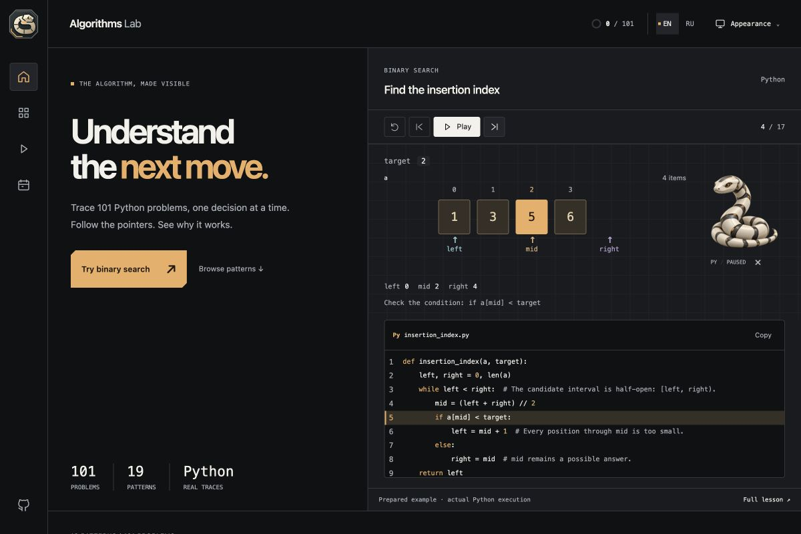

# Algorithms Lab

**Разбирайте паттерны собеседований на Python по шагам.**

**101 задача**, **19 разборов паттернов** и **404 подготовленных примера** с проверкой ожидаемых ответов. Английский по умолчанию, полный русский режим на выбор.

**[Открыть демо на русском →](https://glec1er.github.io/algorithms/?lang=ru)** · [Начать с бинарного поиска](https://glec1er.github.io/algorithms/?lang=ru#/problem/insertion_index) · [English README](README.md)

[](https://glec1er.github.io/algorithms/?lang=ru)

Без аккаунта и сервера. Без аналитики. Лицензия MIT.

## Возможности

- Массивы, указатели, окна, хеш-таблицы, списки, деревья, trie, графы, кучи, интервалы, DP, перебор, биты и геометрия.
- Пауза, шаг назад/вперёд, скорость, сброс и шкала шагов.
- Подсветка выполняемой строки, переменные, узлы с постоянными идентификаторами и стек вызовов.
- Поиск по двум языкам, фильтр сложности, ссылки на задачи, локальные отметки прогресса.
- Календарь практики: одна новая задача в каждый будний день, XP, уровни, серии и достижения.
- Подробные разборы всех 19 паттернов: распознавание, шаги решения, мини-пример и ошибки.
- Мобильная версия, управление клавиатурой и поддержка reduced motion.
- Светлое, тёмное и системное оформление. Необязательный спутник Py, робот-питон, реагирует на шаги алгоритма; его можно скрыть или отключить движение в настройках оформления. [Устройство Py](docs/mascot.md).

## Разбор за минуту

1. Откройте [«Позиция вставки»](https://glec1er.github.io/algorithms/?lang=ru#/problem/insertion_index): найдите место для `2` в массиве `[1, 3, 5, 6]`.
2. Нажимайте **→** для перехода по шагам или **пробел** для воспроизведения. Следите за `left`, `mid` и `right` рядом с Python-кодом; ответ — индекс `1`. Состояние показано **перед** выполнением выделенной строки.
3. Выберите другой **Пример**, откройте разбор **Binary Search** под проигрывателем или переключите **EN / RU**, сохранив текущий шаг.


## Язык и резервные копии

Переключатель English / Русский сохраняет задачу, выбранный пример, шаг анимации и прогресс. Язык сохраняется; ссылки могут явно задавать `?lang=ru` или `?lang=en` перед маршрутом `#/problem/...`.

В календаре доступны «Скачать прогресс» и «Восстановить из файла». Файл проверяется локально, затем показывается предварительный просмотр. Перед заменой автоматически скачивается копия текущего состояния. Повреждённый файл не меняет историю.

## Календарь и цель

Откройте «Календарь» в шапке. Новая задача засчитывается при первом нажатии «Отметить»; повторное переключение отметки не приносит XP. Цель — минимум одна новая задача с понедельника по пятницу. Выходные добровольные и не прерывают серию. После прохождения всех задач обязательные цели прекращаются.

Каждая новая задача даёт 100 XP, следующий уровень — через 500 XP. Старые отметки переносятся без вымышленных дат. Снятие отметки для повторного разбора сохраняет историю первого закрытия. Прогресс хранится только в этом браузере; очистка его данных удалит историю. При недоступном хранилище текущая вкладка продолжает работать с предупреждением.

## Локальный запуск

Нужны Node.js 24+ (в CI используется 24), npm и Python 3.10+ без сторонних Python-пакетов.

```bash
npm ci
npm run dev
```

Откройте адрес, напечатанный Vite, с путём `/algorithms/`.

```bash
npm test                 # Python-решения, инварианты и трассировщик
npm run build            # генерация занятий, TypeScript и production-сборка
npm run check            # генерация занятий, Python и проверка типов
npm run preview          # просмотр dist на порту 4173
npm run test:browser     # все занятия и управление в Chrome
```

Для браузерной проверки локально используется установленный Google Chrome. В CI используется Chromium из Playwright (`CI=true`, предварительно `npx playwright install --with-deps chromium`).

Клавиатура: `←` и `→` меняют шаг; пробел управляет воспроизведением, когда фокус вне поля ввода или кнопки. Сфокусированные кнопки работают стандартно через пробел/Enter.

## Устройство

- `curriculum/catalog.py` — главы, объяснения, сложность, примеры с независимо заданными ожидаемыми ответами.
- `curriculum/ch01.py` … `ch19.py` — оригинальные алгоритмы на Python.
- `curriculum/structures.py` — адаптеры входных примеров и типы узлов. Подготовка и отображение примеров не включены в указанную сложность алгоритма.
- `curriculum/runtime.py` — ограниченная запись фактических Python line events. Снимок показывает состояние **перед** выделенной строкой; последний снимок содержит результат.
- `scripts/build_lessons.py` — проверка результатов и генерация `src/catalog.json`, `public/lessons/*.json`.
- `src/components/` — визуальные сцены и подсветка кода, `src/App.tsx` — каталог и проигрыватель.
- `tests/` — проверки алгоритмов, записи состояний и интерфейса.

Сайт статический: Python выполняется во время сборки. В браузере воспроизводятся записанные состояния выбранного примера; выполнение пользовательского Python и произвольные входы не поддерживаются. Каждое занятие загружается отдельно. Перестановки элементов сохраняют идентичность карточек; циклические ссылки узлов кодируются через ID.

## GitHub Pages

В Settings → Pages выбран источник **GitHub Actions**. Workflow `pages.yml` проверяет Python, собирает сайт, проходит все задачи в браузере и публикует `dist` при обновлении `main`. Pull request запускает проверки без публикации; доступен ручной запуск. Дополнительные секреты не нужны.

Base path — `/algorithms/`; маршруты вида `#/problem/insertion_index` работают при прямом открытии. Для другого имени репозитория измените `base` в `vite.config.ts`.

## Материалы

Порядок и состав 101 задачи сверены с [официальным каталогом ByteByteGo](https://bytebytego.com/exercises/coding-patterns), который объединяет задачи книги и дополнительные задачи авторов. Дополнительные задачи вне этого списка не заявлены как покрытые. Объяснения, примеры, код и визуализации алгоритмов — оригинальные материалы проекта; страницы книги и оригинальные иллюстрации здесь не размещены. Изображение Py создано для проекта с помощью генерации изображений; подробности приведены в [описании маскота](docs/mascot.md).

Это независимый учебный проект, не официальный продукт ByteByteGo. Код проекта распространяется по MIT; исходные материалы книги принадлежат их авторам.
