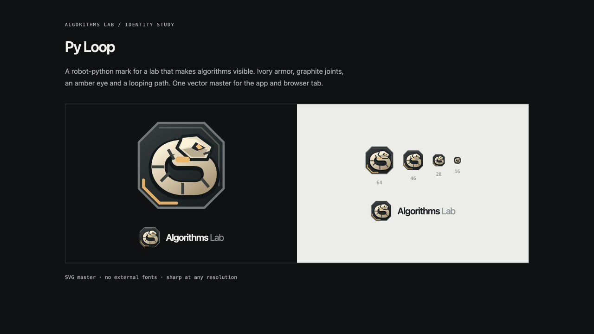

# Py Loop

Py Loop is Algorithms Lab's original vector mark: a geometric robot-python head, a coiled path, ivory armor, graphite joints and an amber eye. It connects the app's identity with Py, its robot-python companion.

The master is `public/brand-mark.svg`, drawn on a 64 × 64 grid. `BrandMark` displays the same asset in the desktop rail and mobile header; the browser favicon also uses this file. The rail keeps a 72 px heading area aligned with the page header, with a 46 px mark. The compact phone header uses 28 px.

The mark has its own graphite plate and ivory/amber palette, so its silhouette retains contrast in both application themes. Keep the view box and outer plate intact when resizing. Use the SVG master for exports; no raster generation, custom font or external asset is required.

